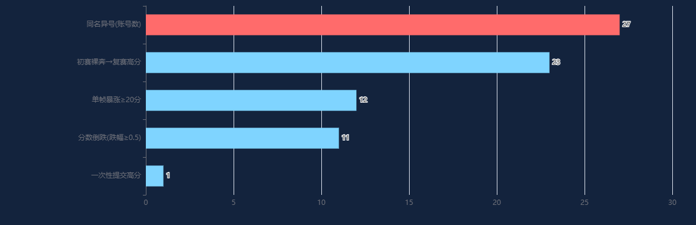
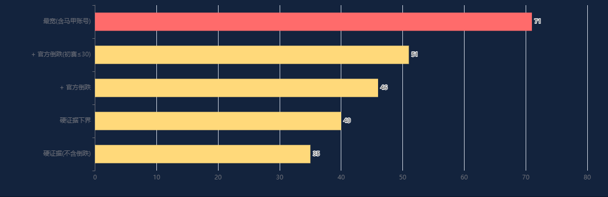

# 2026AIC- 榜单监控数据

这是个人从复赛开始到结束，通过记录每天的复赛成绩排行榜数据整理的数据，不作为比赛成绩评分参考。

## 仓库内容

| 路径 | 说明 |
|---|---|
| `data/rank_snapshots.json` | 初赛榜单整点快照（275 帧，2026-09-06 16:00 → 2026-09-20 12:00）——**已公开存档**；采集不完整（部分时段缺失），仅作存档参考，未单独制作可视化 |
| `data/rank_snapshots_fs.json` | 复赛榜单整点快照（483 帧，2026-09-21 20:00 → 2026-10-11 22:00） |
| `analysis/index.html` | 数据分析报告（ECharts 可视化，双击即可在浏览器打开） |
| `analysis/cheat_analysis.html` | 可疑队伍画像分析（暴涨 / 同分 / 综合可疑度，统计模式识别） |
| `analysis/images/` | 分析报告导出的图表 PNG |
| `static/echarts.min.js` | 报告依赖的 ECharts 库 |

## 交互式分析报告（建议用浏览器打开，可直接交互）

| 报告 | 内容 |
|---|---|
| [analysis/index.html](analysis/index.html) | 基础分析：队伍总数、分数分布、单帧暴涨、获奖线演化、迭代活跃度、排名波动等 12 图 |
| [analysis/cheat_analysis.html](analysis/cheat_analysis.html) | 可疑队伍画像：暴涨 Top30、同分簇、综合可疑度、初赛↔复赛反差、卡线、轨迹 6 图 |
| [analysis/drop_analysis.html](analysis/drop_analysis.html) | 分数倒跌：榜单"取最高分"机制下分数单调性检验，14 起倒跌事件全明细 |
| [analysis/lowerbound.html](analysis/lowerbound.html) | 作弊队伍数量下界估计：五类异常信号 + 分层下界（35/46/51/71 队） |

> 提示：GitHub 在线预览 HTML 时，可先打开 `analysis/` 目录再点文件；本地使用请 `git clone` 后双击文件打开。

## 数据口径

- 数据来自赛事官方公开榜单接口（`POST /third/jsphb`），无需登录，整点采集
- 每帧为按分数倒序排列的队伍列表，字段：`rank`（排名）/ `name`（队名）/ `no`（编号）/ `score`（分数）
- 复赛榜单自 2026-10-05 起冻结，末帧共 553 队

## 分析结果要点（详见 `analysis/index.html`）

- 483 帧快照，累计出现 554 支队伍，末帧 553 队
- 末帧分数分布：55-60 分区间扎堆 269 队（48.6%）
- 90 队存在单帧暴涨 ≥5 分（其中 12 队 ≥20 分）；异常判定为统计层面的模式识别，不构成对任何队伍的定性结论
- 初赛 557 队 → 复赛 554 队：533 队两赛均上榜

## 图表预览

### 1. 队伍总数增长曲线

> 上榜队伍数随时间持续增长，末帧定格 553 队；说明复赛周期内不断有新队伍完成首次提交。

### 2. 分带人数演化

> 各分数段人数随赛程迁移：55-60 分段（省三线上下）越到后期越扎堆，末帧 269 队占 48.6%，竞争最密集。

### 3. 末帧分数分布

> 末帧 553 队分数呈右偏分布，绝大多数落在 40-60 分；60+ 仅 4 队，头部优势明显。

### 4. 单帧暴涨分布

> 统计每队全部帧间涨幅的最大值：绝大多数队伍单帧涨幅 0-5 分（正常迭代），尾部 90 队出现过 ≥5 分跳变，12 队 ≥20 分。

### 5. 暴涨事件时间聚类

> ≥5 分的暴涨事件集中爆发于 10/04-10/05，与榜单冻结前的最后冲刺期吻合，也是异常集中区。

### 6. 单帧暴涨 Top30

> 涨幅最高的 30 队：AC 单帧 +59.273 分居首，蓄势待发 +48.909、凌云队 +47.757 紧随其后——正常迭代很难一帧跳这么多。

### 7. 名次-分数曲线

> 末帧排名与分数关系：约 1 分横跨 100 个名次，57 分附近每 0.1 分能拉开 10+ 名，说明获奖线附近竞争极度拥挤。

### 8. 获奖线演化

> 按末帧 553 队 ×15%/25%/30% 计算的省一/省二/省三线随时间演化，末帧定格 57.903 / 57.275 / 57.060。

### 9. 末次提交时间分布

> 各队最后一次分数变化的时间分布：绝大多数队伍 10/05 前完成最终提交，榜单 10/05 后进入冻结状态。

### 10. 初赛 vs 复赛

> 初赛 557 队 → 复赛 554 队，533 队两赛均上榜；两赛分数对照可见大量队伍复赛显著提升。

### 11. 迭代活跃度

> 各队分数变化次数分布：大部分队伍迭代 0-5 次，少数队伍只有 1 次提交即定格，是异常画像的重要线索。

### 12. 排名波动

> 队伍排名相对自身初赛/早期的波动幅度：426 队被后来者挤后移超 100 名，榜单后期洗牌剧烈。

## 可疑队伍画像分析（`analysis/cheat_analysis.html`）

基于整点快照对末帧 553 队做统计模式识别，供复核参考，不构成对任何队伍的定性结论：

- **单帧暴涨**：60 队存在单帧跳分 ≥5 分，其中 12 队 ≥20 分（异常级）
- **末帧完全同分**：仅 1 组（57.321 分三队撞分）；分数为 3 位小数，完全同分概率极低
- **综合可疑度**：单帧暴涨 / 一次性提交高分 / 晚现即高分 / 初赛↔复赛反差 / 排名跃升 / 卡获奖线 / 末帧同分簇 / 同名异号 8 项特征加权评分
- 最集中的模式：初赛占位（8~10 分）→ 复赛 57~59 分一次性上榜（20+ 队），及单帧暴涨 ≥20 分、分数精确卡获奖线（±0.02）

### 13. 单帧暴涨 Top30

> 同图 6，以可疑画像视角重排：涨幅头部队伍与末帧获奖线位置对照，暴涨后多数稳定在高位。

### 14. 综合可疑度 Top20

> 8 项统计特征加权的可疑度得分 Top20：目标检测小分队 60 分居首（暴涨+卡线+排名跃升三合一），供组委会复核参考。

### 15. 末分 vs 综合可疑度

> 553 队全量散点：右上角=高分且高可疑，是重点复查区；多数队伍聚集在中低可疑区。

### 16. 初赛 vs 复赛反差

> 初赛末分 vs 复赛末分：左上角（初赛 8-10 分、复赛 57-59 分）20+ 队踩中「买项目」典型画像，反差最剧烈。

### 17. 卡线队伍

> 末分距省一/省二/省三线 ≤0.05 的队伍：目标检测小分队精确落在省三线 57.060（距 0.000），像按获奖线交付的成品。

### 18. 重点可疑队伍轨迹

> 5 支重点可疑队整赛轨迹：蓄势待发单帧 +48.9 从低分直冲 57+，从容应队只出现一次即 58.7，暴涨节点一目了然。

## 分数倒跌分析（`analysis/drop_analysis.html`）

榜单按「取最高分」展示，正常分数应单调不降。483 帧快照检出 14 起倒跌（14 队），其中 10 起发生在官方明确"不再修改分数"（10/02）之后；原因由组委会判定，本报告仅作数据呈现。

### 19. 倒跌事件按日分布

> 14 起分数倒跌按日期分布：红色=10/02 官方声明「不再修改分数」之后发生（10 起），其中 10/04 21:00 单帧 3 队同跌。

### 20. 倒跌队伍轨迹

> 重点倒跌队轨迹：这把就赢了 10/02 单帧 -3.999，重生之算法精英队 10/06 被砍 0.276 后正好跌出省三线 57.060。

## 作弊队伍数量下界估计（`analysis/lowerbound.html`）

### 21. 异常信号命中数

> 五类强行为信号命中队伍数：同名异号 27 账号（13 组）、初赛裸奔→复赛高分 23 队、单帧暴涨≥20 分 12 队、分数倒跌 11 队、一次性提交高分 1 队。

### 22. 下界分层估计

> 保守下界：单帧暴涨≥20 ∪ 初赛裸奔→复赛高分 = **35 队（零重叠，行为无法用正常迭代解释）**；叠加官方倒跌 46 队、初赛口径放宽后 51 队、最宽含马甲 71 队。

## 许可证

[MIT License](LICENSE)
