# 2026AIC- 榜单监控数据

这是个人从复赛开始到结束，通过记录每天的复赛成绩排行榜数据整理的数据，不作为比赛成绩评分参考。

## 仓库内容

| 路径 | 说明 |
|---|---|
| `data/rank_snapshots.json` | 初赛榜单整点快照（275 帧，2026-09-06 16:00 → 2026-09-20 12:00）——**已公开存档**；采集不完整（部分时段缺失），仅作存档参考，未单独制作可视化 |
| `data/rank_snapshots_fs.json` | 复赛榜单整点快照（483 帧，2026-09-21 20:00 → 2026-10-11 22:00） |
| `data/prize_verdict.json` | 官方公示结果交叉数据（553队：编号/队名/分数/等级/排名，不含成员姓名） |
| `data/killed_teams.json` | 被官方斩杀20队名单（冻结榜该获奖但公示未获奖） |
| `analysis/index.html` | 数据分析报告（ECharts 可视化，双击即可在浏览器打开） |
| `analysis/cheat_analysis.html` | 可疑队伍画像分析（暴涨 / 同分 / 综合可疑度，统计模式识别） |
| `analysis/images/` | 分析报告导出的图表 PNG |
| `static/echarts.min.js` | 报告依赖的 ECharts 库 |

## 交互式分析报告（建议用浏览器打开，可直接交互）

| 报告 | 内容 |
|---|---|
| [analysis/index.html](analysis/index.html) | 基础分析：队伍总数、分数分布、单帧暴涨、获奖线演化、迭代活跃度、排名波动等 12 图 |
| [analysis/cheat_analysis.html](analysis/cheat_analysis.html) | 可疑队伍画像：暴涨 Top30、同分簇、综合可疑度、初赛↔复赛反差、卡线、轨迹 6 图 |
| [analysis/drop_analysis.html](analysis/drop_analysis.html) | 分数倒跌：榜单"取最高分"机制下分数单调性检验，14 起倒跌事件全明细 |
| [analysis/lowerbound.html](analysis/lowerbound.html) | 作弊队伍数量下界估计：五类异常信号 + 分层下界（35/46/51/71 队） |
| [analysis/prize_verdict.html](analysis/prize_verdict.html) | **公示交叉分析**：被官方斩杀20队画像、作弊规律特征命中率、漏网预测名单 |

> 提示：GitHub 在线预览 HTML 时，可先打开 `analysis/` 目录再点文件；本地使用请 `git clone` 后双击文件打开。

## 数据口径

- 数据来自赛事官方公开榜单接口（`POST /third/jsphb`），无需登录，整点采集
- 每帧为按分数倒序排列的队伍列表，字段：`rank`（排名）/ `name`（队名）/ `no`（编号）/ `score`（分数）
- 复赛榜单自 2026-10-05 起冻结，末帧共 553 队

## 分析结果要点（详见 `analysis/index.html`）

- 483 帧快照，累计出现 554 支队伍，末帧 553 队
- 末帧分数分布：55-60 分区间扎堆 269 队（48.6%）
- 90 队存在单帧暴涨 ≥5 分（其中 12 队 ≥20 分）；异常判定为统计层面的模式识别，不构成对任何队伍的定性结论
- 初赛 557 队 → 复赛 554 队：533 队两赛均上榜

## 图表预览

### 1. 队伍总数增长曲线

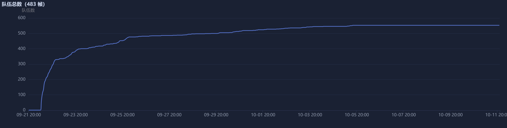
> 上榜队伍数随时间持续增长，末帧定格 553 队；说明复赛周期内不断有新队伍完成首次提交。

### 2. 分带人数演化

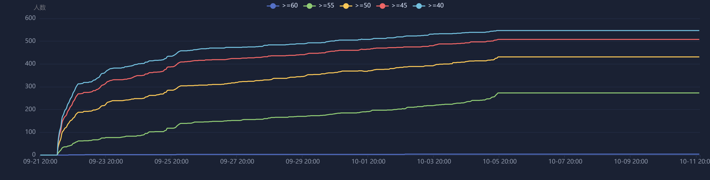
> 各分数段人数随赛程迁移：55-60 分段（省三线上下）越到后期越扎堆，末帧 269 队占 48.6%，竞争最密集。

### 3. 末帧分数分布

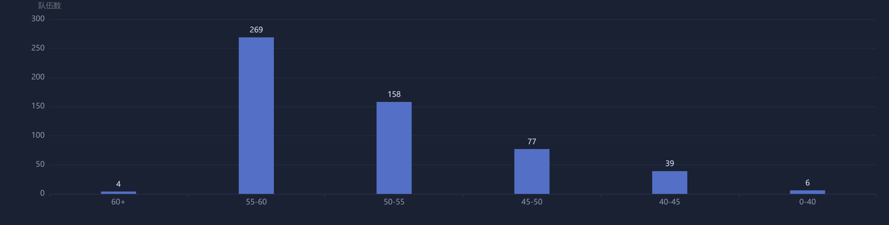
> 末帧 553 队分数呈右偏分布，绝大多数落在 40-60 分；60+ 仅 4 队，头部优势明显。

### 4. 单帧暴涨分布

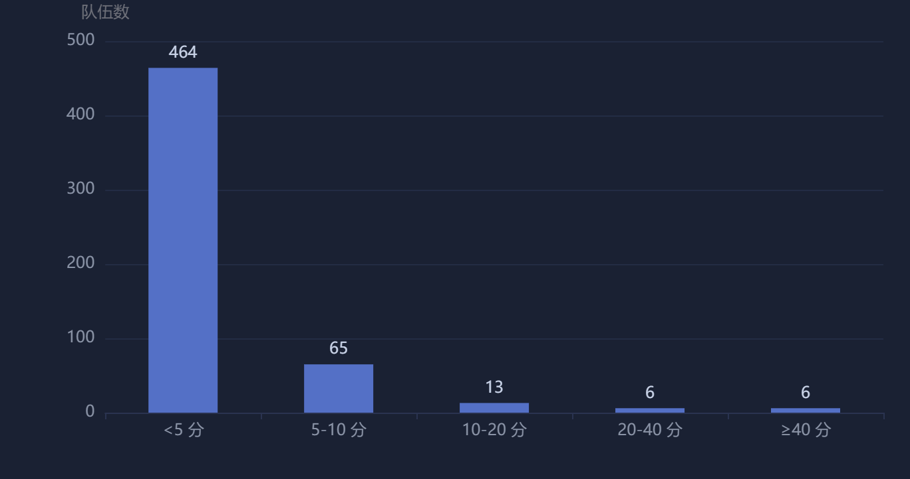
> 统计每队全部帧间涨幅的最大值：绝大多数队伍单帧涨幅 0-5 分（正常迭代），尾部 90 队出现过 ≥5 分跳变，12 队 ≥20 分。

### 5. 暴涨事件时间聚类

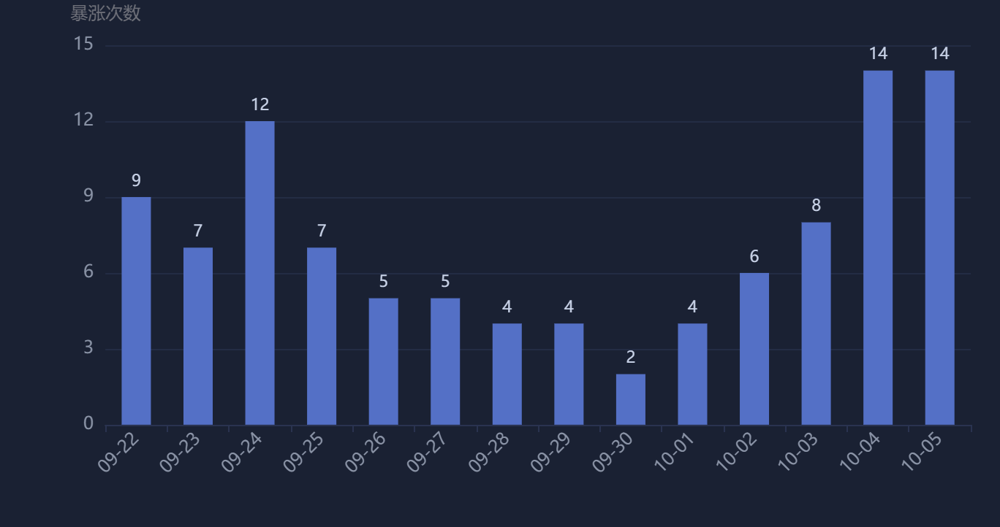
> ≥5 分的暴涨事件集中爆发于 10/04-10/05，与榜单冻结前的最后冲刺期吻合，也是异常集中区。

### 6. 单帧暴涨 Top30

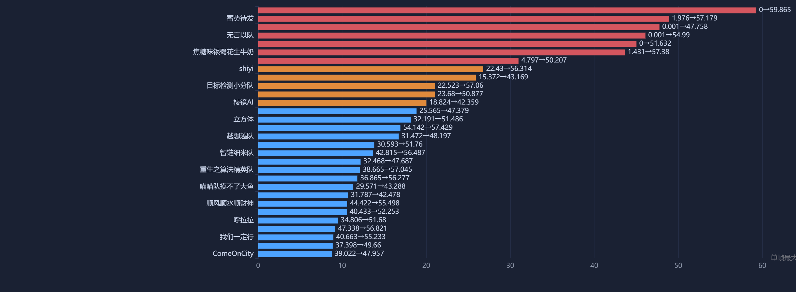
> 涨幅最高的 30 队：AC 单帧 +59.273 分居首，蓄势待发 +48.909、凌云队 +47.757 紧随其后——正常迭代很难一帧跳这么多。

### 7. 名次-分数曲线

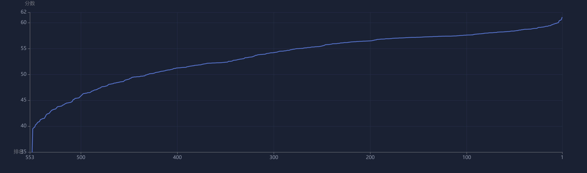
> 末帧排名与分数关系：约 1 分横跨 100 个名次，57 分附近每 0.1 分能拉开 10+ 名，说明获奖线附近竞争极度拥挤。

### 8. 获奖线演化

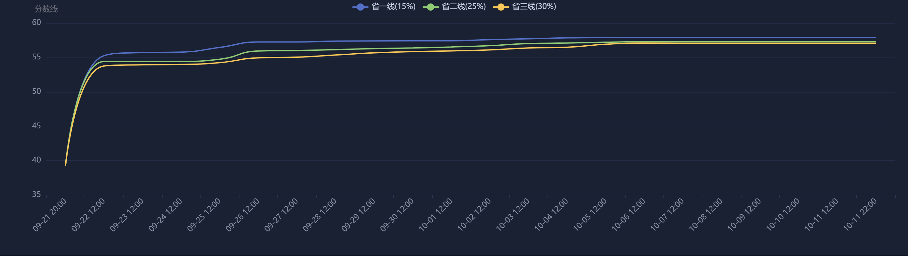
> 按末帧 553 队 ×15%/25%/30% 计算的省一/省二/省三线随时间演化，末帧定格 57.903 / 57.275 / 57.060。

### 9. 末次提交时间分布

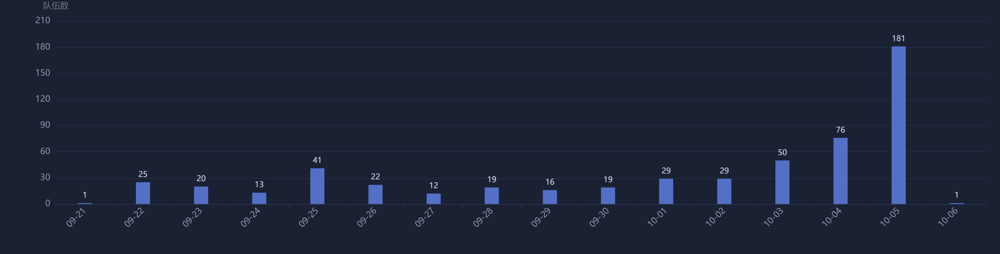
> 各队最后一次分数变化的时间分布：绝大多数队伍 10/05 前完成最终提交，榜单 10/05 后进入冻结状态。

### 10. 初赛 vs 复赛

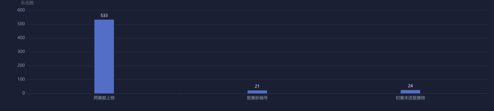
> 初赛 557 队 → 复赛 554 队，533 队两赛均上榜；两赛分数对照可见大量队伍复赛显著提升。

### 11. 迭代活跃度

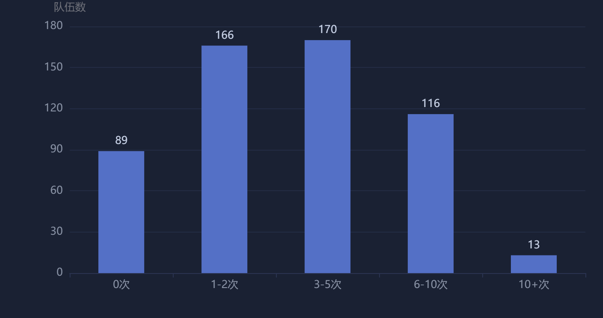
> 各队分数变化次数分布：大部分队伍迭代 0-5 次，少数队伍只有 1 次提交即定格，是异常画像的重要线索。

### 12. 排名波动

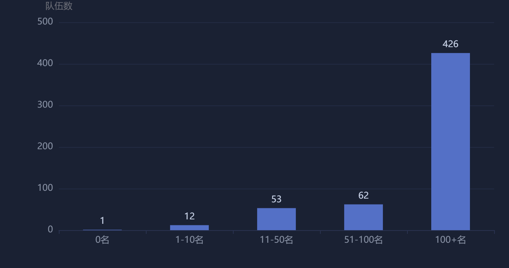
> 队伍排名相对自身初赛/早期的波动幅度：426 队被后来者挤后移超 100 名，榜单后期洗牌剧烈。

## 可疑队伍画像分析（`analysis/cheat_analysis.html`）

基于整点快照对末帧 553 队做统计模式识别，供复核参考，不构成对任何队伍的定性结论：

- **单帧暴涨**：60 队存在单帧跳分 ≥5 分，其中 12 队 ≥20 分（异常级）
- **末帧完全同分**：仅 1 组（57.321 分三队撞分）；分数为 3 位小数，完全同分概率极低
- **综合可疑度**：单帧暴涨 / 一次性提交高分 / 晚现即高分 / 初赛↔复赛反差 / 排名跃升 / 卡获奖线 / 末帧同分簇 / 同名异号 8 项特征加权评分
- 最集中的模式：初赛占位（8~10 分）→ 复赛 57~59 分一次性上榜（20+ 队），及单帧暴涨 ≥20 分、分数精确卡获奖线（±0.02）

### 13. 单帧暴涨 Top30

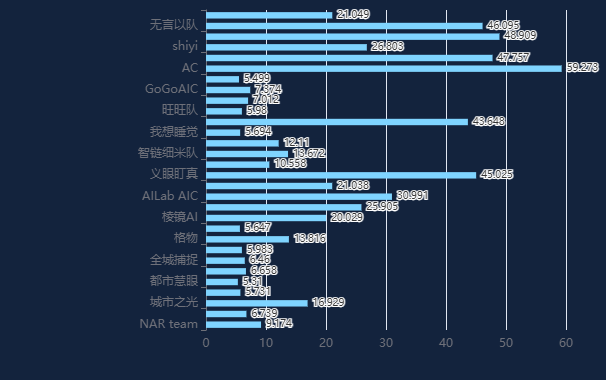
> 同图 6，以可疑画像视角重排：涨幅头部队伍与末帧获奖线位置对照，暴涨后多数稳定在高位。

### 14. 综合可疑度 Top20

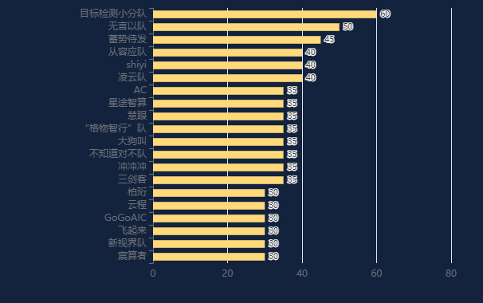
> 8 项统计特征加权的可疑度得分 Top20：目标检测小分队 60 分居首（暴涨+卡线+排名跃升三合一），供组委会复核参考。

### 15. 末分 vs 综合可疑度

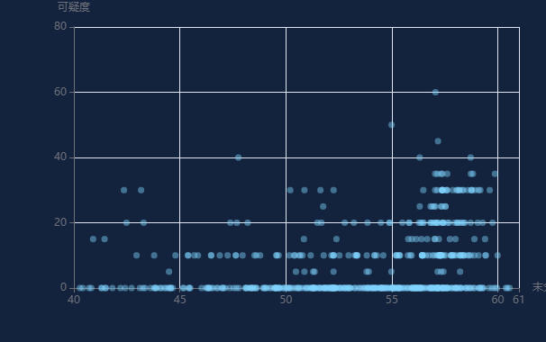
> 553 队全量散点：右上角=高分且高可疑，是重点复查区；多数队伍聚集在中低可疑区。

### 16. 初赛 vs 复赛反差

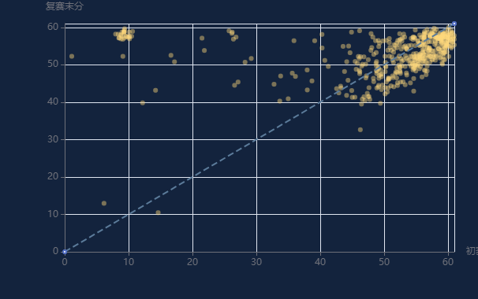
> 初赛末分 vs 复赛末分：左上角（初赛 8-10 分、复赛 57-59 分）20+ 队踩中「买项目」典型画像，反差最剧烈。

### 17. 卡线队伍

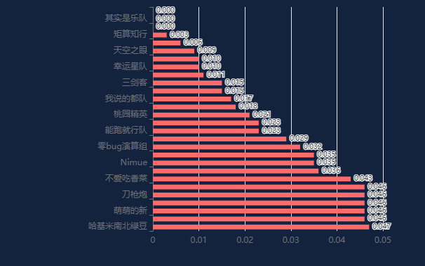
> 末分距省一/省二/省三线 ≤0.05 的队伍：目标检测小分队精确落在省三线 57.060（距 0.000），像按获奖线交付的成品。

### 18. 重点可疑队伍轨迹

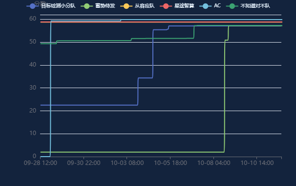
> 5 支重点可疑队整赛轨迹：蓄势待发单帧 +48.9 从低分直冲 57+，从容应队只出现一次即 58.7，暴涨节点一目了然。

## 分数倒跌分析（`analysis/drop_analysis.html`）

榜单按「取最高分」展示，正常分数应单调不降。483 帧快照检出 14 起倒跌（14 队），其中 10 起发生在官方明确"不再修改分数"（10/02）之后；原因由组委会判定，本报告仅作数据呈现。

### 19. 倒跌事件按日分布

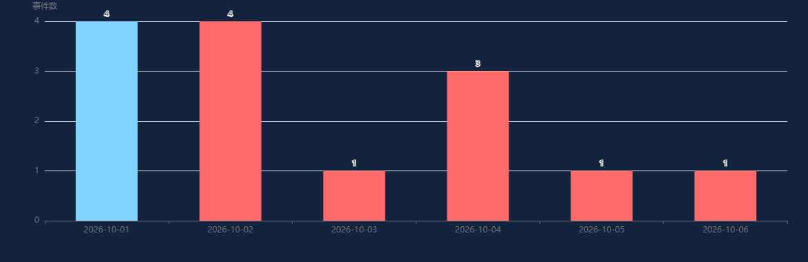
> 14 起分数倒跌按日期分布：红色=10/02 官方声明「不再修改分数」之后发生（10 起），其中 10/04 21:00 单帧 3 队同跌。

### 20. 倒跌队伍轨迹

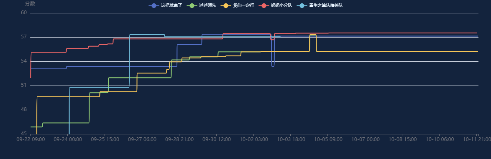
> 重点倒跌队轨迹：这把就赢了 10/02 单帧 -3.999，重生之算法精英队 10/06 被砍 0.276 后正好跌出省三线 57.060。

## 作弊队伍数量下界估计（`analysis/lowerbound.html`）

### 21. 异常信号命中数

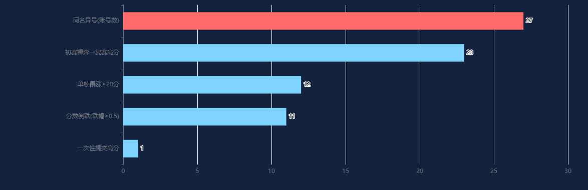
> 五类强行为信号命中队伍数：同名异号 27 账号（13 组）、初赛裸奔→复赛高分 23 队、单帧暴涨≥20 分 12 队、分数倒跌 11 队、一次性提交高分 1 队。

### 22. 下界分层估计

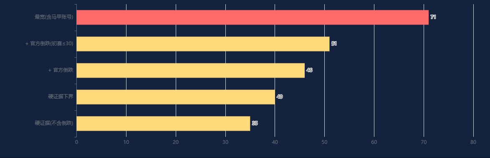
> 保守下界：单帧暴涨≥20 ∪ 初赛裸奔→复赛高分 = **35 队（零重叠，行为无法用正常迭代解释）**；叠加官方倒跌 46 队、初赛口径放宽后 51 队、最宽含马甲 71 队。

## 公示交叉分析：被斩杀队伍与漏网预测（`analysis/prize_verdict.html`）

官方公示拟获奖名单后，将其与本地483帧监控快照交叉，得到以下结论：

### 被官方斩杀的20队

定义：冻结榜分数落在省一/二/三档内（前388名），但公示未获奖。分两类：

- **A类·高分凭空冒头（9队，58.7~61分）**：5队初赛缺考直接冒59+（扬帆队61.067、算力先锋60.558、定风波59.399、维度解耦59.308、扬帆远航59.303）；3队初赛前10但复测翻车（FK/AC/ini）；慧眼初赛10分532名0次变更一步到位。
- **B类·卡线同分簇（11队，56.3~57.4分）**：4个同分簇共9队全灭——57.321三队（恒视科创/不知道对不队/刀枪炮）、57.396两队（火爆奶龙/对的对的）、57.285两队（幸运星/别跟我们作队）、56.363两队（知行合一/城视融合）。

### 作弊规律（特征命中率对比）

| 特征 | 被斩杀20队 | 获奖385队 | 倍数 |
|---|---:|---:|---:|
| 同分簇（2队以上分数精确相同） | 45% | 7.3% | 6.2× |
| 初赛缺考 | 25% | 3.1% | 8× |
| 初赛弱复赛强 | 35% | 19.2% | 1.8×（弱） |
| 提交≤2次变更 | 45% | 40.5% | 1×（无区分度） |

真正硬的规律：① 2~3个初赛中游弱队抱团同分卡在省二线；② 初赛缺考直接买高分。初赛弱复赛强、提交次数少不是作弊证据。

### 漏网预测（按与被斩杀队相似度排序）

1. **58.721 刷漆队 + 从容应队（省一）**：两个初赛477/517名极弱队同分拿省一，画像与被斩杀的慧眼（532名/58.731分/未获奖）几乎一样。
2. **57.380 厚积薄发 + 焦糖味银鹭花生牛奶（省二）**：两个初赛170名左右弱队同分，复刻被斩杀的57.396簇。
3. **57.004 汉津智眸 + 清风一咪（省二）**：两个弱队同分卡省二线。
4. **4个初赛缺考独分队**（雄鹰队57.538、老天保佑队57.525、矩算知行57.057、智链细米队56.487，均省二）。

> 以上为统计画像相似度，不构成作弊指控；官方公示结果为最终裁定。

### 被官方斩杀的 20 队名单（完整公开）

> 定义：复赛冻结榜分数落在省一/二/三档内（前 388 名），但官方公示拟获奖名单中未出现。
> 数据来源：官方公示名单 × 本地复赛整点监控快照交叉比对（不含成员姓名）。

| 冻结榜排名 | 队伍编号 | 队名 | 冻结分数 | 本应奖项 | 画像 |
|---:|---|---|---:|---|---|
| 1 | AIC-2026-17614590 | 扬帆队 | 61.067 | 省一 | A·初赛缺考直出高分 |
| 2 | AIC-2026-12582072 | 算力先锋 | 60.558 | 省一 | A·初赛缺考直出高分 |
| 4 | AIC-2026-36511411 | FK | 60.383 | 省一 | A·初赛前10复测翻车 |
| 7 | AIC-2026-13092655 | AC | 59.865 | 省一 | A·初赛前10复测翻车（单帧暴涨+20） |
| 8 | AIC-2026-18834955 | ini | 59.859 | 省一 | A·初赛前10复测翻车 |
| 15 | AIC-2026-90643004 | 定风波队 | 59.399 | 省一 | A·初赛缺考直出高分 |
| 16 | AIC-2026-68457276 | 维度解耦 | 59.308 | 省一 | A·初赛缺考直出高分 |
| 17 | AIC-2026-22667495 | 扬帆远航 | 59.303 | 省一 | A·初赛缺考直出高分 |
| 37 | AIC-2026-31567721 | 慧眼 | 58.731 | 省一 | A·初赛10分垫底一步到位 |
| 118 | AIC-2026-85813535 | 火爆奶龙队 | 57.396 | 省二 | B·同分簇（与119同分） |
| 119 | AIC-2026-50650446 | 对的对的 | 57.396 | 省二 | B·同分簇（与118同分） |
| 132 | AIC-2026-19244943 | 恒视科创队 | 57.321 | 省二 | B·同分簇（与133/134同分） |
| 133 | AIC-2026-76610325 | 刀枪炮 | 57.321 | 省二 | B·同分簇（与132/134同分） |
| 134 | AIC-2026-91512263 | 不知道对不队 | 57.321 | 省二 | B·同分簇（与132/133同分） |
| 136 | AIC-2026-55765440 | 别跟我们作队 | 57.285 | 省二 | B·同分簇（与137同分） |
| 137 | AIC-2026-99852489 | 幸运星队 | 57.285 | 省二 | B·同分簇（与136同分） |
| 170 | AIC-2026-52464888 | 我说的都队 | 57.043 | 省二 | B·卡线（非簇） |
| 213 | AIC-2026-23217153 | 城视融合 | 56.363 | 省二 | B·同分簇（与214同分） |
| 214 | AIC-2026-69878034 | 知行合一 | 56.363 | 省二 | B·同分簇（与213同分） |
| 246 | AIC-2026-31096930 | 一往无前队 | 55.755 | 省三 | B·卡线（非簇） |

**画像分类**：
- **A 类 · 高分凭空冒头（9 队）**：初赛缺考直接冒 59+ 分、或初赛前 10 复测翻车、或初赛垫底一步到位——正常迭代无法解释。
- **B 类 · 卡线同分簇（11 队）**：2~3 队分数精确到 3 位小数完全同分并卡在获奖线上，同分簇全灭——按获奖线交付的成品画像。

> 以上为数据呈现，官方公示结果为最终裁定。

## 许可证

[MIT License](LICENSE)
