# 2026AIC- 榜单监控数据

这是个人从复赛开始到结束，通过记录每天的复赛成绩排行榜数据整理的数据，不作为比赛成绩评分参考。

## 仓库内容

| 路径 | 说明 |
|---|---|
| `data/rank_snapshots.json` | 初赛榜单整点快照（275 帧，2026-09-06 16:00 → 2026-09-20 12:00） |
| `data/rank_snapshots_fs.json` | 复赛榜单整点快照（483 帧，2026-09-21 20:00 → 2026-10-11 22:00） |
| `analysis/index.html` | 数据分析报告（ECharts 可视化，双击即可在浏览器打开） |
| `analysis/cheat_analysis.html` | 可疑队伍画像分析（暴涨 / 同分 / 综合可疑度，统计模式识别） |
| `analysis/images/` | 分析报告导出的图表 PNG |
| `static/echarts.min.js` | 报告依赖的 ECharts 库 |

## 数据口径

- 数据来自赛事官方公开榜单接口（`POST /third/jsphb`），无需登录，整点采集
- 每帧为按分数倒序排列的队伍列表，字段：`rank`（排名）/ `name`（队名）/ `no`（编号）/ `score`（分数）
- 复赛榜单自 2026-10-05 起冻结，末帧共 553 队

## 分析结果要点（详见 `analysis/index.html`）

- 483 帧快照，累计出现 554 支队伍，末帧 553 队
- 末帧分数分布：55-60 分区间扎堆 269 队（48.6%）
- 90 队存在单帧暴涨 ≥5 分（其中 12 队 ≥20 分）；异常判定为统计层面的模式识别，不构成对任何队伍的定性结论
- 初赛 557 队 → 复赛 554 队：533 队两赛均上榜

## 图表预览

### 1. 队伍总数增长曲线

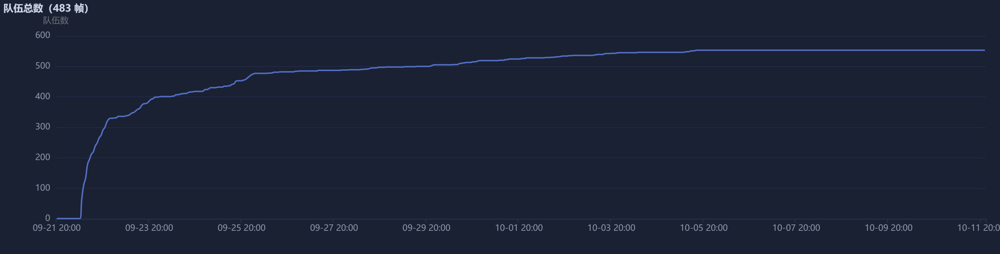

### 2. 分带人数演化

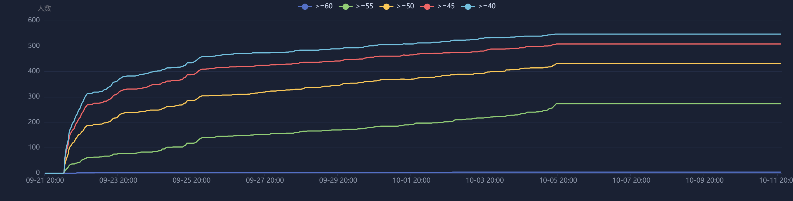

### 3. 末帧分数分布

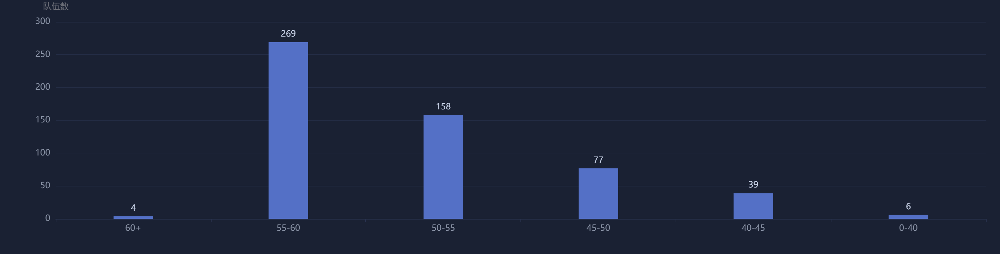

### 4. 单帧暴涨分布

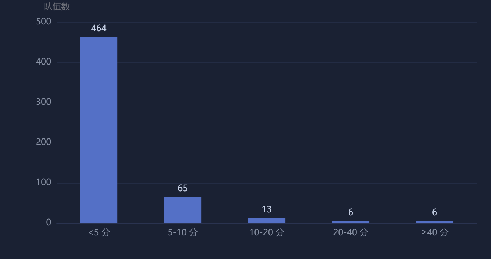

### 5. 暴涨事件时间聚类

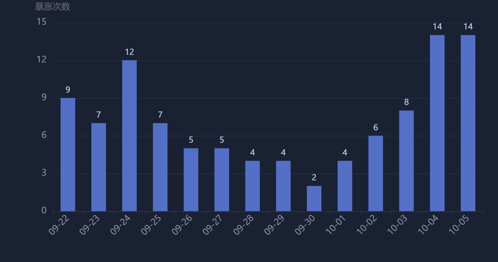

### 6. 单帧暴涨 Top30

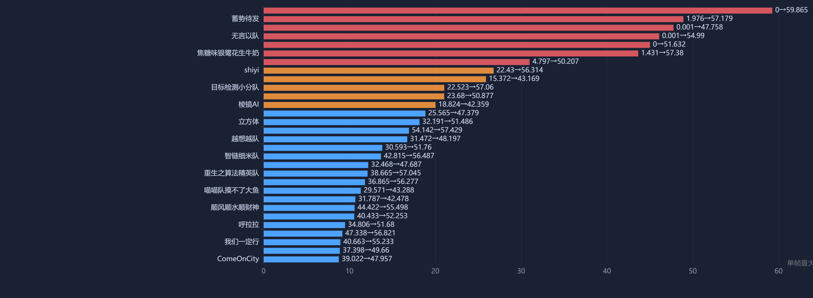

### 7. 名次-分数曲线

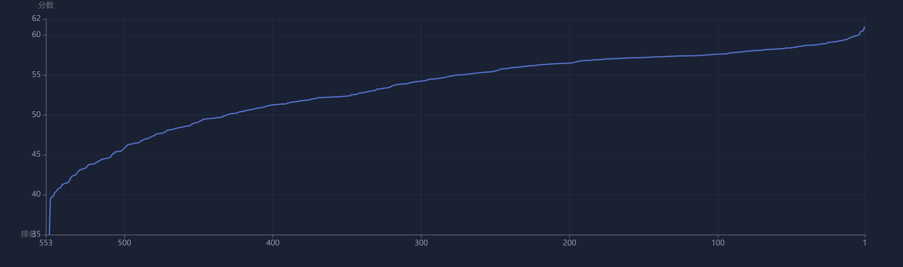

### 8. 获奖线演化

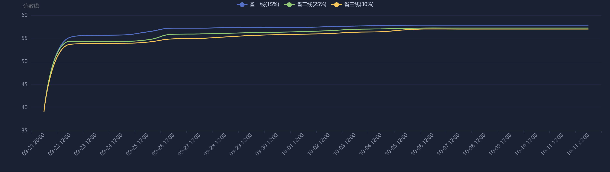

### 9. 末次提交时间分布

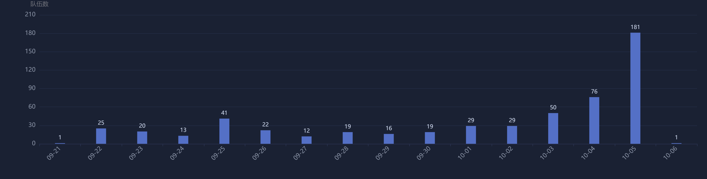

### 10. 初赛 vs 复赛

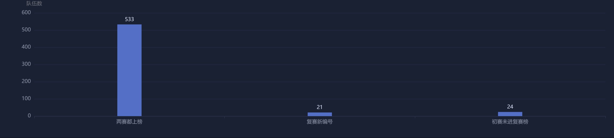

### 11. 迭代活跃度

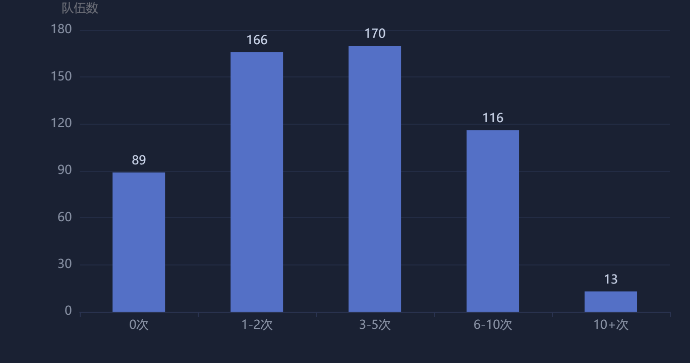

### 12. 排名波动

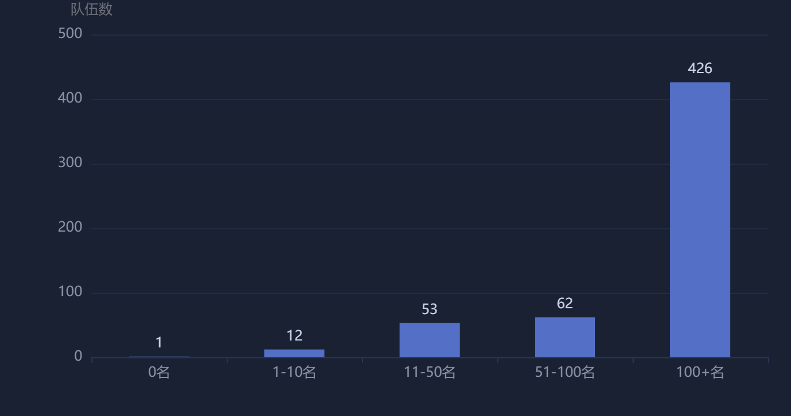

## 可疑队伍画像分析（`analysis/cheat_analysis.html`）

基于整点快照对末帧 553 队做统计模式识别，供复核参考，不构成对任何队伍的定性结论：

- **单帧暴涨**：60 队存在单帧跳分 ≥5 分，其中 12 队 ≥20 分（异常级）
- **末帧完全同分**：仅 1 组（57.321 分三队撞分）；分数为 3 位小数，完全同分概率极低
- **综合可疑度**：单帧暴涨 / 一次性提交高分 / 晚现即高分 / 初赛↔复赛反差 / 排名跃升 / 卡获奖线 / 末帧同分簇 / 同名异号 8 项特征加权评分
- 最集中的模式：初赛占位（8~10 分）→ 复赛 57~59 分一次性上榜（20+ 队），及单帧暴涨 ≥20 分、分数精确卡获奖线（±0.02）

### 13. 单帧暴涨 Top30

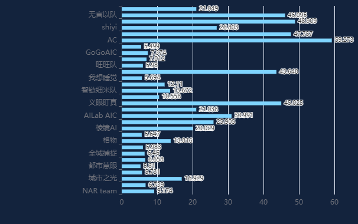

### 14. 综合可疑度 Top20

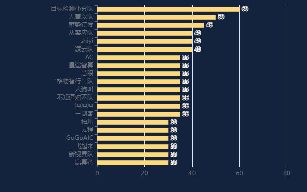

### 15. 末分 vs 综合可疑度

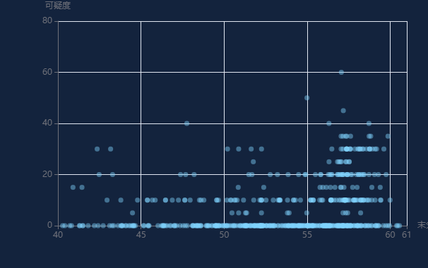

### 16. 初赛 vs 复赛反差

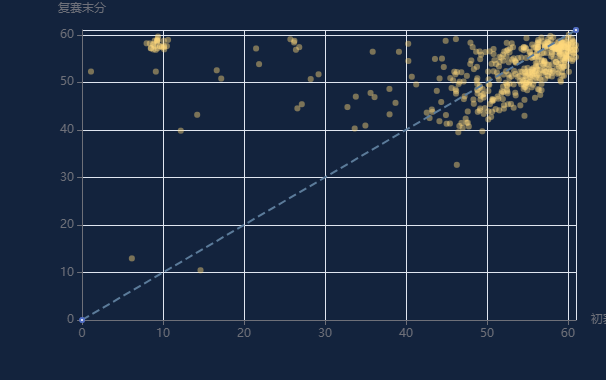

### 17. 卡线队伍

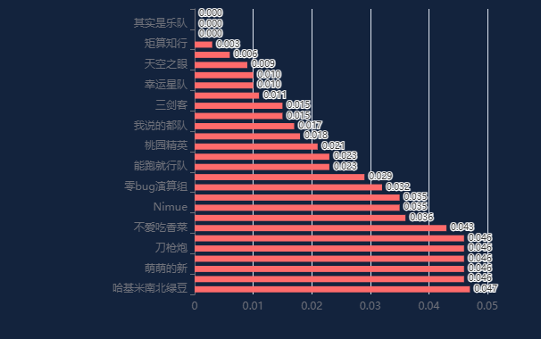

### 18. 重点可疑队伍轨迹

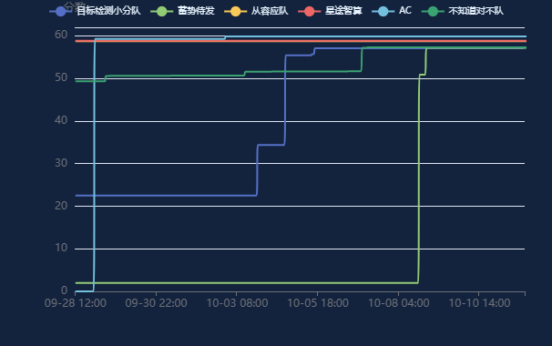

## 分数倒跌分析（`analysis/drop_analysis.html`）

榜单按「取最高分」展示，正常分数应单调不降。483 帧快照检出 14 起倒跌（14 队），其中 10 起发生在官方明确"不再修改分数"（10/02）之后；原因由组委会判定，本报告仅作数据呈现。

### 19. 倒跌事件按日分布

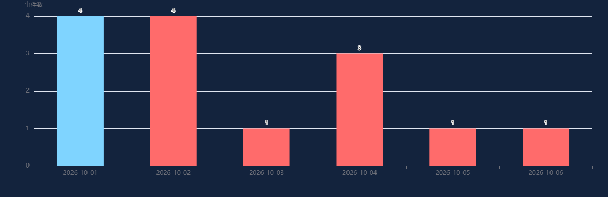

### 20. 倒跌队伍轨迹

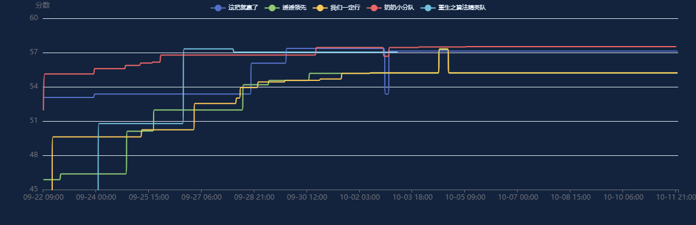

## 许可证

[MIT License](LICENSE)
